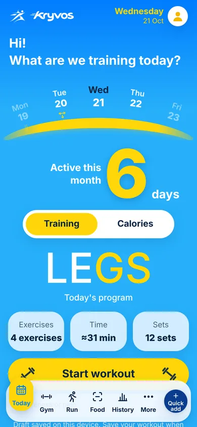
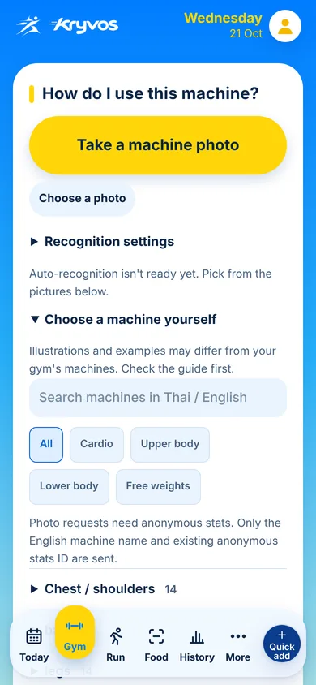
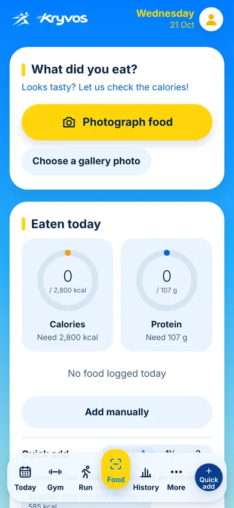
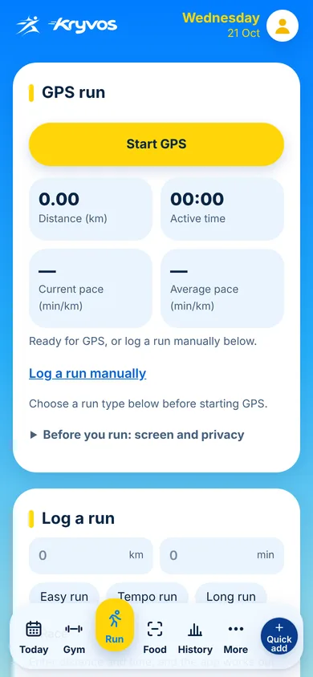
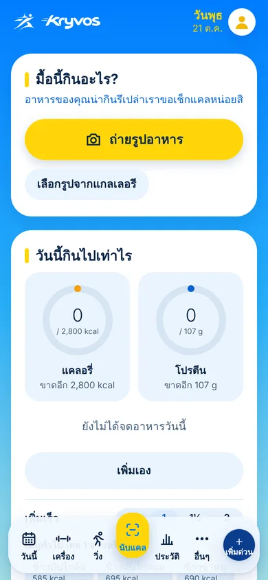
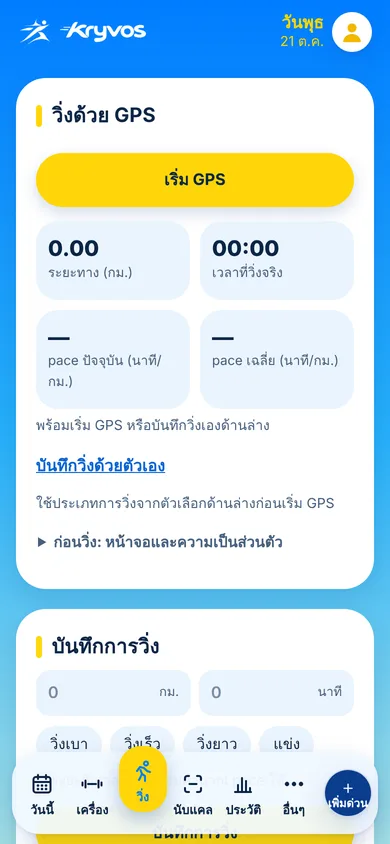

# KRYVOS

**An AI daily training coach that answers one question every morning: _what should I train today, and what should I avoid if something is sore or hurts?_**

**Open the app:** https://nrw18.github.io/train-today/ · Android test APK: [releases/android-test](https://github.com/NRW18/train-today/releases/tag/android-test)

## Why
I lead my school's track team and train in a gym. Every day I had the same problem: which muscles are recovered, what to skip when my knee or shoulder hurts, and how much weight to use. Existing apps either ask for a full plan up front or ignore pain. KRYVOS decides for you in one tap and explains why.

## What it does
- **Picks today's workout** (PUSH / PULL / LEGS / rest) from 48-hour muscle recovery, your energy and time, and **skips every exercise that loads a sore or painful muscle or joint**, with a clear "see a doctor" warning. Rules are deterministic, so every choice has a reason.
- **Logs every set** with suggested weight (double progression), a rest timer, progress graphs and drafts that survive closing the app.
- **Gym machines (AI):** photograph a machine and Gemini matches it to a 58-machine catalog (real, openly licensed photos), or proposes a new exercise that you confirm. Search and filters for the catalog.
- **Calories (AI):** photograph a meal for an editable calorie and protein table; quick Thai dishes; goals for gain / maintain / lose using Mifflin-St Jeor with safety floors.
- **Running:** GPS tracking with pace, manual runs, weekly load warnings, shoe finder and shoe mileage.
- **Weekly AI summary** from your real numbers.
- **Private by default:** all data lives on the phone; works offline as an installable PWA (and Android TWA). Thai and English.

## How AI is used safely
- Gemini runs behind our own **Cloudflare Worker**, so users need no API key and the key never reaches the browser. Per-user and per-app daily limits.
- **Every AI answer is validated** before use (unknown IDs dropped, numbers clamped, JSON shape checked) and the user confirms before anything is saved.
- The app **never diagnoses**: pain means skip and suggest a doctor.

## Built with Codex
Features are built as small pull requests with **OpenAI Codex**, each reviewed and merged only when a suite of ~290 Node tests passes (`node --test "tests/*.test.mjs"`) that run the real app code. See [AGENTS.md](AGENTS.md) for the rules every agent follows and the [closed pull requests](https://github.com/NRW18/train-today/pulls?q=is%3Apr+is%3Aclosed) for the history.

**Stack:** plain HTML/CSS/JS (no framework, no build), Service Worker, Gemini API, Cloudflare Workers + KV + D1, GitHub Pages, Android TWA.

Made by **Norrawat Nakphut & Krittanun Boonman**. Not medical advice.

---

## ภาษาไทย

แอปโค้ชซ้อมรายวัน (ชื่อเดิม "วันนี้ฝึกอะไร") ตอบคำถามที่ผมต้องถามทุกวัน: **วันนี้ควรฝึกอะไร** และ **ถ้าเมื่อยหรือเจ็บตรงไหน ควรเลี่ยงท่าไหน** พร้อมบันทึกวิ่ง หารองเท้าวิ่ง และนับแคลอรี่ตามเป้าเพิ่มหรือลดน้ำหนัก

**เปิดแอป:** https://nrw18.github.io/train-today/

อยากช่วยพัฒนา: อ่าน [TEAM.md](TEAM.md)

## หน้าตาแอป

- **แบรนด์:** พื้นฟ้าไล่เฉด ปุ่มหลักสีเหลือง โลโก้นักวิ่งและคำว่า Kryvos สีเหลือง มีโหมดมืดเป็นฟ้าเข้ม
- **แถบเมนูล่าง 6 แท็บ:** วันนี้ · เครื่อง · วิ่ง · นับแคล · ประวัติ · อื่นๆ แท็บที่เปิดอยู่เป็นช่องเหลืองยกขึ้น และมีปุ่ม "เพิ่มด่วน"
- **หน้าวันนี้:** คำทักทาย แถบวันแบบโค้ง จำนวนวันที่ออกกำลังกายในเดือนนี้ สลับ "การฝึก / แคล" ชื่อโปรแกรมวันนี้ การ์ดจำนวนท่า เวลา และเซ็ต และปุ่ม "เริ่มฝึก"
- **ทุกแท็บ:** หน้าละหนึ่งปุ่มหลักสีเหลือง ตัวเลือกรองพับเก็บไว้ ไม่มีฟีเจอร์หาย
- **สีบอกสถานะ:** เขียว = พร้อม, ส้ม = เมื่อย, แดง = เจ็บ, ม่วง = วิ่ง และมีคำกำกับเสมอ
- รองรับจอ 320–430px ภาษาไทยและอังกฤษ การใช้คีย์บอร์ด และการตั้งค่าลดการเคลื่อนไหว

## ทำอะไรได้
- **สแกนเครื่องในยิมด้วยกล้อง (AI):** ถ่ายรูปเครื่อง Google Gemini บอกว่าเป็นเครื่องอะไรและเล่นท่าไหนได้ ถ้าเป็นเครื่องที่แอปยังไม่รู้จัก AI จะเสนอเป็นท่าใหม่พร้อมกล้ามที่ใช้และข้อต่อที่โดน แอปตรวจคำตอบของ AI ก่อนใช้เสมอ และให้ผู้ใช้ยืนยันก่อนเพิ่ม ผลสแกนแสดงวิธีเล่น จำนวนเซ็ตและครั้งที่แนะนำ และแชร์ได้ ท่าที่ AI เพิ่มลบออกได้ โดยประวัติการซ้อมท่านั้นยังอยู่ครบ
- **สรุปโปรแกรมวันนี้:** เครื่องไหน กี่เซ็ต กี่ครั้ง น้ำหนักเท่าไร อยู่บนสุดของหน้า
- **ตัวจับเวลาพัก:** กด ✓ จบเซ็ตแล้วนับถอยหลังเอง ครบเวลาสั่นและมีเสียง
- **วิธีเล่นแต่ละท่า:** ขั้นตอนและจุดที่พลาดบ่อย ท่าที่ AI เพิ่มเข้ามาให้ AI เขียนคำอธิบายได้
- **วิดีโอสอนจาก YouTube:** ทุกท่ามีปุ่มเปิดวิดีโอภาษาไทยและภาษาอังกฤษ ผลสแกนเครื่องมีปุ่มดูวิธีเล่น และแท็บเครื่องมีช่อง "สงสัยท่าไหน" ค้นได้ทุกท่า (ใช้ลิงก์ค้นหา จึงไม่มีลิงก์เสียและไม่ต้องใช้คีย์)
- **ถ่ายรูปอาหาร (AI, แท็บนับแคล):** ตารางแคลอรี่แต่ละส่วนประกอบพร้อมยอดรวม แก้ตัวเลขได้ก่อนบันทึก เทียบกับเป้ารายวัน และดูยอดแคลอรี่ของแต่ละวันในสัปดาห์นี้
- **เพิ่มอาหารเร็ว:** แตะเมนูไทยทั่วไปหรือมื้อที่กินบ่อย เลือกขนาด ½ / 1 / 1½ / 2 ได้
- **เป้าเพิ่มกล้าม คงน้ำหนัก หรือลดน้ำหนัก:** คำนวณเป้าแคลอรี่และโปรตีนจากเพศ อายุ ส่วนสูง น้ำหนัก และการออกกำลังกาย (Mifflin-St Jeor) ลดน้ำหนักไม่ต่ำกว่าพลังงานขณะพัก
- **น้ำหนักตัว:** กราฟ และบอกแนวโน้มต่อสัปดาห์ตามเป้าว่าช้า พอดี หรือเร็วไป
- **แท็บวิ่ง:** บันทึกระยะ เวลา และแบบการวิ่ง ดูระยะ 8 สัปดาห์ เตือนเมื่อเพิ่มระยะเกิน 10% และนับระยะรองเท้าที่ใช้อยู่
- **หารองเท้าวิ่ง:** แนะนำ 3 รุ่นตามแบบการใช้ (ซ้อมทั่วไป นุ่ม ซ้อมเร็ว แข่ง เทรล) รุ่นชายหรือหญิง หน้าเท้า อุ้งเท้า น้ำหนักตัว และงบ ราคาป้ายจากเว็บทางการในไทย
- **สรุป 7 วัน:** สถิติคำนวณในเครื่อง และ AI สรุปพร้อมคำแนะนำจากตัวเลขจริง
- **เช็กอินรายวัน:** เลือกช่วงเวลา (เช้าเล่นช่วงบน / เย็นเล่นขา), ระดับแรง และส่วนที่เมื่อยหรือเจ็บ
- **เลือกโปรแกรมให้:** PUSH / PULL / LEGS หรือวันพักฟื้น จากเวลาที่กล้ามแต่ละส่วนได้พัก (48 ชม.) พร้อมบอกเหตุผล
- **ตัดท่าที่ไม่ควรเล่น:** เมื่อยตัดท่าที่ใช้ส่วนนั้นเป็นหลัก เจ็บตัดทุกท่าที่โดนส่วนนั้นหรือข้อต่อนั้น และแสดงคำเตือนว่าเมื่อไหร่ควรพบแพทย์
- **แนะนำน้ำหนัก:** แบบ double progression (8–12 ครั้ง ทำครบ 12 ทุกเซ็ตแล้วเพิ่ม 2.5 กก.)
- **บันทึกและดูความก้าวหน้า:** บันทึกทุกเซ็ต ดูกราฟน้ำหนักแต่ละท่า
- **ติดตั้งเป็นแอปบนมือถือ (PWA):** ใช้ได้แม้ไม่มีเน็ตในยิม
- **ข้อมูลไม่หาย:** สำรองและนำเข้าเป็นไฟล์ได้ (รวมข้อมูลร่างกายและรองเท้า) เปิดแอป 2 แท็บพร้อมกันได้โดยข้อมูลไม่ทับกัน "ลบข้อมูลทั้งหมด" ลบทุกอย่าง เหลือไว้แค่ภาษาและคีย์ Gemini ของผู้ใช้
- **สองภาษา:** อังกฤษเป็นหลัก มีภาษาไทยสำหรับคนไทย (เปิดเป็นไทยอัตโนมัติถ้ามือถือตั้งภาษาไทย) สลับได้ที่แท็บ "อื่นๆ" AI ตอบเป็นภาษาที่เลือก

## วิธีตัดสินใจ
- **AI (Gemini):** จำเครื่องจากรูป, ประเมินอาหารจากรูป, อธิบายท่าใหม่ และสรุปรายสัปดาห์ ผู้ใช้ใส่ API key ฟรีของตัวเอง เก็บไว้ในเครื่องเท่านั้น คำตอบของ AI ถูกตรวจก่อนใช้เสมอ (เช่น ตัด id ที่ไม่มีจริง, จำกัดโปรตีนไม่ให้เกินแคลอรี่/4) และผู้ใช้ยืนยันก่อนบันทึก
- **การเลือกโปรแกรมและน้ำหนัก:** เป็นกฎจากหลักการฝึกความแข็งแรง เพื่อให้คาดเดาได้และอธิบายเหตุผลได้ทุกครั้ง
- **ข้อมูลการซ้อม:** เก็บในเครื่องของผู้ใช้เท่านั้น

## แอป Android
- **ดาวน์โหลด APK (ทดสอบ):** https://github.com/NRW18/train-today/releases/tag/android-test
- สร้างอัตโนมัติด้วย GitHub Actions (`.github/workflows/android.yml`) เป็น Trusted Web Activity ห่อเว็บแอปนี้ (`android/`)
- ไฟล์ทดสอบเซ็นด้วยกุญแจชั่วคราวที่สร้างใหม่ทุกครั้ง ถ้าจะลง Google Play จริง ต้องใช้กุญแจถาวรที่เก็บเป็น secret ของ repo และวางไฟล์ assetlinks.json ที่ https://nrw18.github.io/.well-known/ เพื่อซ่อนแถบที่อยู่เว็บ

## ตัวกลาง AI (proxy/worker.js)
Cloudflare Worker ที่เก็บ Gemini key เป็น secret ผู้ใช้จึงใช้ AI ได้ทันทีโดยไม่ต้องใส่คีย์ รับเฉพาะคำขอจากแอปนี้ ตรวจรูปแบบคำขอ และจำกัดคนละ 40 ครั้งต่อวัน (ทั้งแอปรวม 450 ครั้งต่อวัน) ผ่าน Workers KV ไม่ส่งรายละเอียด error ของ Google กลับไปที่แอป ถ้า KV ใช้ไม่ได้ ตัวกลางยังตอบได้ตามปกติแต่ไม่นับครั้ง ถ้าติดต่อ Google ไม่ได้จะตอบ 502 (แอปลองใหม่ 1 ครั้ง)

**Deploy ด้วย wrangler** (ต้องมี Node.js) ค่าตั้งอยู่ใน `proxy/wrangler.toml`
1. `cd proxy`
2. `npx wrangler login` ล็อกอิน Cloudflare ในเบราว์เซอร์ที่เปิดขึ้นมา
3. `npx wrangler deploy` อัปโหลด `worker.js` ขึ้นไปทับตัวเดิม (`train-today-ai`)

คีย์ `GEMINI_KEY` ตั้งไว้ใน Cloudflare แล้ว deploy ใหม่ไม่ลบคีย์ ห้ามใส่คีย์ในไฟล์ใน repo

`wrangler.toml` ตั้งให้ตรงกับ dashboard แล้ว (เปิด logs ปิด preview URLs) ถ้าไปแก้ค่าใน dashboard ให้แก้ไฟล์นี้ด้วย ไม่งั้น deploy ครั้งหน้าจะถามว่าจะเขียนทับไหม ถ้าไม่แน่ใจให้ตอบ n ก่อน

## สถิติการใช้งาน (หลังบ้าน)
แอปนับว่าแต่ละฟีเจอร์ถูกใช้กี่ครั้ง แบบไม่ระบุตัวตน แล้วส่งไปเก็บใน Cloudflare D1 (`kryvos-stats`) ผ่านตัวกลางตัวเดียวกัน (`POST /e`)
- **ส่งไป:** รหัสสุ่มของเครื่อง ภาษา ชนิดมือถือ ติดตั้งแล้วหรือยัง และชื่อฟีเจอร์ (ดูรายชื่อที่ `EVENTS` ใน `proxy/worker.js`)
- **ไม่ส่ง:** ชื่อ IP น้ำหนัก อาหาร การซ้อม หรือสิ่งที่พิมพ์ ผู้ใช้ปิดได้ที่แท็บ "อื่นๆ" → สถิติการใช้งาน
- **ดูตัวเลข:** เปิด https://nrw18.github.io/train-today/stats.html แล้วใส่รหัส `STATS_KEY` (ดูหน้าตาด้วยข้อมูลปลอมได้ที่ `stats.html?demo`)
- **ตั้งค่าครั้งแรก (ทำแล้ว):** `npx wrangler d1 create kryvos-stats` ใส่ `database_id` ใน `wrangler.toml` แล้ว `npx wrangler secret put STATS_KEY` ตั้งรหัสเอง ตารางสร้างเองตอนมีข้อมูลเข้าครั้งแรก
- **เพิ่มฟีเจอร์ที่จะนับ:** ใส่ชื่อใน `EVENTS` ของ worker, เรียก `track("ชื่อ")` ในแอป, ใส่ชื่อภาษาไทยใน `NAMES` ของ `stats.html` แล้ว deploy ตัวกลางใหม่
- **เพดานฟรีของ D1:** เขียนได้ 100,000 แถวต่อวัน แอปจำกัดไว้เครื่องละ 400 ครั้งต่อวัน

**ทดสอบ:** `node --test "tests/*.test.mjs"` (ที่โฟลเดอร์หลักของ repo)

## เข้าสู่ระบบด้วย Google และสำรองออนไลน์ (ไม่บังคับ)

- ปิดอยู่จนกว่าจะใส่ OAuth client ID ใน `auth-config.js` และ `proxy/wrangler.toml` (`GOOGLE_CLIENT_ID`) ไม่มี client secret
- แอปใช้ได้ครบโดยไม่ต้องเข้าสู่ระบบ ข้อมูลอยู่ในเครื่องเสมอ (`train-today-v1`)
- เมื่อผู้ใช้ยอมรับเท่านั้น แอปจะส่งข้อมูลเดียวกับไฟล์ "สำรองข้อมูล" **ไม่รวมรูปถ่าย** ไปเก็บใน D1 ผูกกับรหัสบัญชี Google (`sub`) ไม่เก็บอีเมลหรือชื่อ
- เซสชันเก็บเป็นค่า hash อายุ 30 วัน ลบข้อมูลและบัญชีได้เองที่แท็บ อื่นๆ
- worker ตรวจ ID token ของ Google เอง (ลายเซ็น, aud, iss, exp, email_verified) และจำกัดจำนวนครั้งต่อวัน
- ตั้งค่าครั้งแรก: สร้าง OAuth Client ID (Web) ใน Google Cloud Console ใส่ Authorized JavaScript origin `https://nrw18.github.io`, รัน `npx wrangler d1 migrations apply kryvos-stats --remote` แล้ว `npx wrangler deploy` ใน `proxy/`

## เทคโนโลยี
HTML, CSS, JavaScript ล้วน (ไม่มี framework), Gemini API (รับรูปภาพ, ตอบเป็น JSON), Service Worker สำหรับใช้ออฟไลน์, Cloudflare Workers + KV (ตัวกลาง AI), GitHub Pages

> ไม่ใช่คำแนะนำทางการแพทย์

Made by Norrawat Nakphut & Krittanun Boonman
